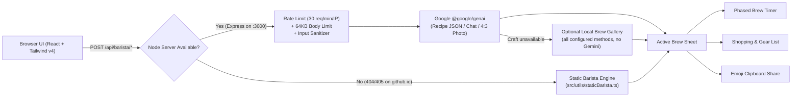
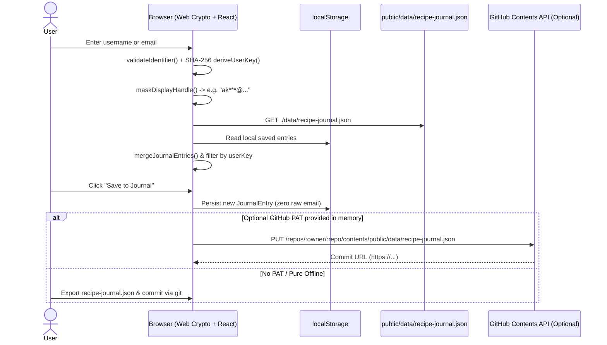

# KaapiWerk — Architecture & System Diagrams

**KaapiWerk** (`కాపీవెర్క్`) by Akarsh Seggemu is a trilingual (English / Deutsch / తెలుగు) specialty coffee crafting studio designed to run identically on a Node/Express server with Gemini AI or as a $0 static website hosted on GitHub Pages (`github.io`).

The interactive system map is a developer-mode view, available at `/?developer=1#how-it-works`; it is omitted from the regular page and navigation. This URL flag controls visibility only and is not an authorization boundary.

---

## 1. End-to-End Request & Fallback Flow

When you click **Craft My Cup**, **Visualize Brew**, or send a message to **Milo**, the browser calls `/api/barista/*`. If deployed on GitHub Pages (no Node backend), a `404`/`405` or network failure falls back to the local static barista engine. If the server is available but Gemini fails, technical errors stay out of the UI: craft offers settings-based local brew previews, visualization uses original local SVG artwork, and chat uses the deterministic local barista reply.

---

## 2. Passwordless Auth & Repository JSON Journal

User accounts require **no password** and **no cloud database**. A username or email is hashed locally in the browser using Web Crypto SHA-256, masked for display, and matched against recipes stored in `localStorage` + `public/data/recipe-journal.json`.

---

## 3. Theme & Telangana Design Tokens

Theme state resolves in three stages to avoid any light-flash on dark OS desktops:
1. **Pre-paint inline `<script>` in `index.html`**: Reads `localStorage["seggamu_kaapi_theme_v1"]` (`"system" | "light" | "dark"`), falls back to `window.matchMedia("(prefers-color-scheme: dark)")`, and toggles `.dark` on `<html>` before CSS paints.
2. **React `useTheme()` hook (`src/hooks/useTheme.ts`)**: Subscribes to `matchMedia` change events when set to `Auto` (`system`) and lets the user override via `<ThemeToggle />`.
3. **Tailwind v4 `@custom-variant dark (&:where(.dark, .dark *));`**: Drives semantic Telangana tokens:

| Role | Light Mode (Deccan Limestone) | Dark Mode (Deccan Basalt) |
| :--- | :--- | :--- |
| Page Canvas | `#F8F5EE` | `#12100E` |
| Elevated Card | `#FFFFFF` | `#1C1917` |
| Recessed Surface | `#EFE9DC` | `#26221E` |
| Primary Ink | `#191614` | `#F5F0E6` |
| Secondary Muted | `#5C534A` | `#B8AFA4` |
| Primary Accent (Pochampally Terracotta) | `#A62C1B` | `#DC4A33` |
| Heritage Gold (Bathukamma Turmeric) | `#B45309` | `#F59E0B` |

---

## 4. Security Boundaries

- **XSS & Injection**: `sanitizeInputText()` strips control characters and `<` / `>` brackets on the server; `validateIdentifier()` restricts identifier length and characters; React escapes all rendered text; GitHub commit URLs are checked with `startsWith("https://")`.
- **Prototype Pollution**: `safeJsonParse()` recursively removes `__proto__`, `constructor`, and `prototype` keys from any parsed JSON (`localStorage` or `recipe-journal.json`).
- **Token Hygiene**: GitHub Personal Access Tokens are held strictly in React state (never written to `localStorage`, `sessionStorage`, or cookies) and wiped on sign-out.
- **API Quota Protection**: `server.ts` enforces a 64KB JSON limit, security headers (`X-Content-Type-Options: nosniff`, `Referrer-Policy`, `Permissions-Policy`), and a 30 requests/minute/IP sliding-window rate limiter on `/api/barista/*`.
